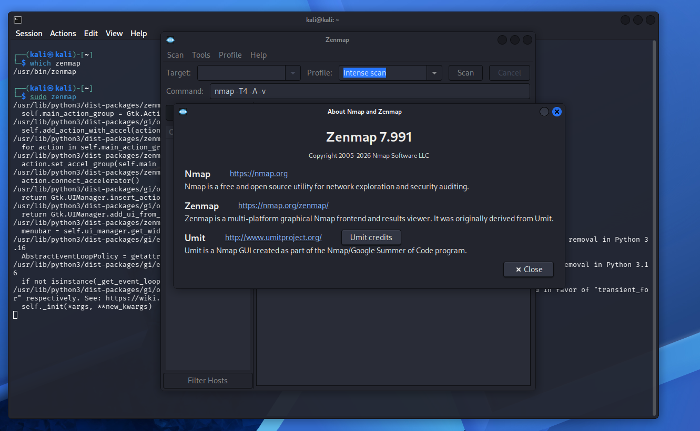
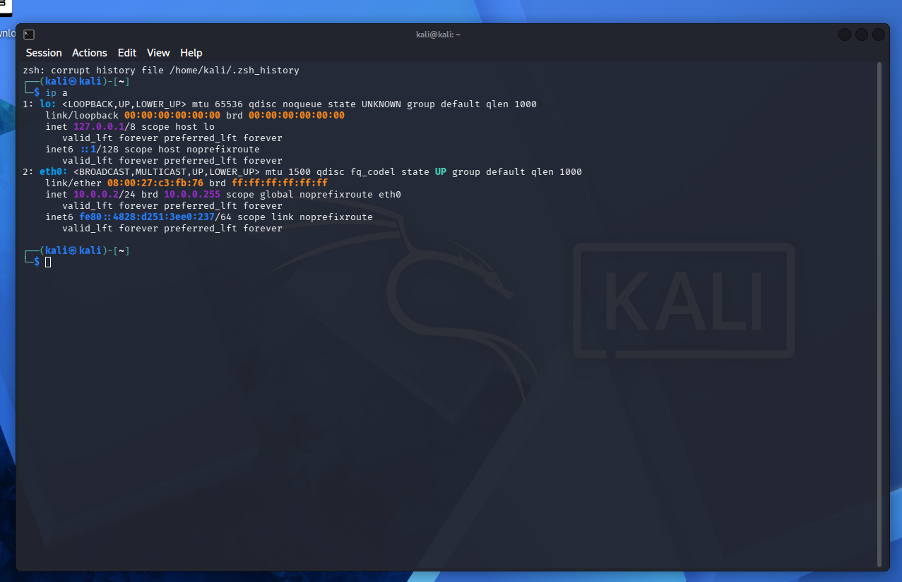
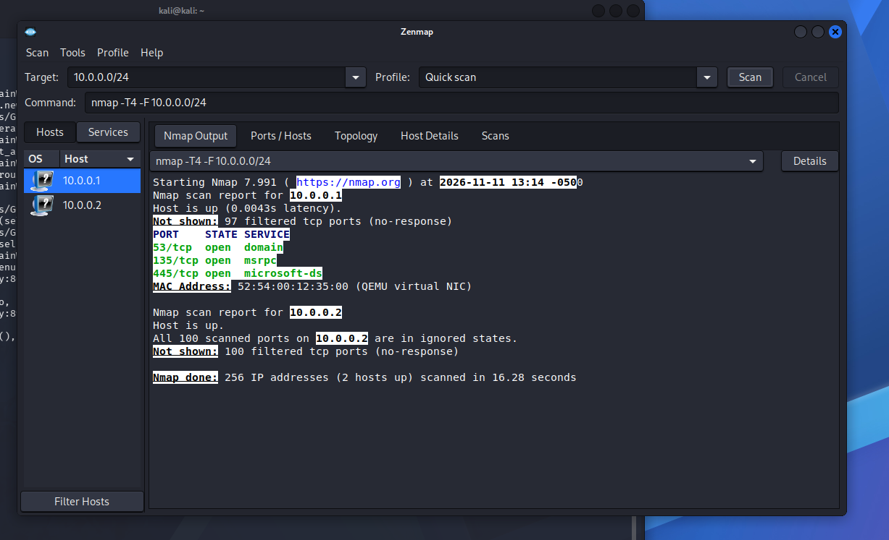
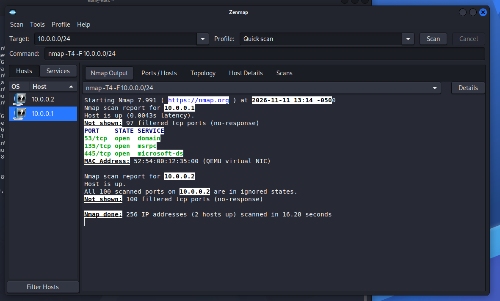
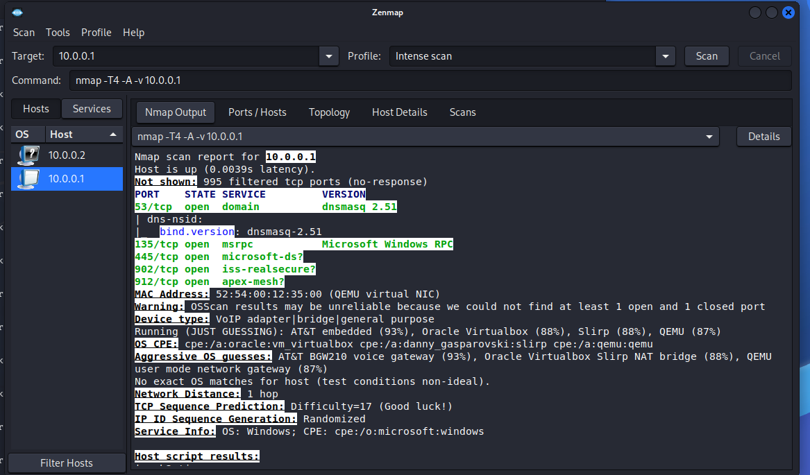
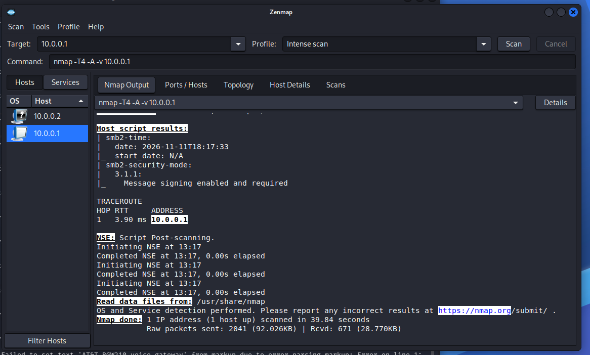
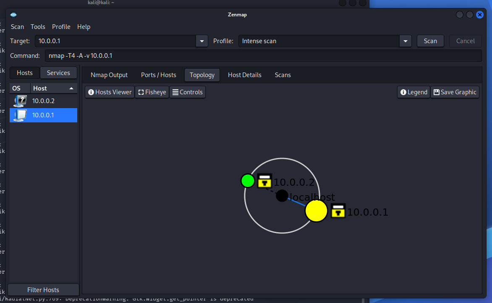
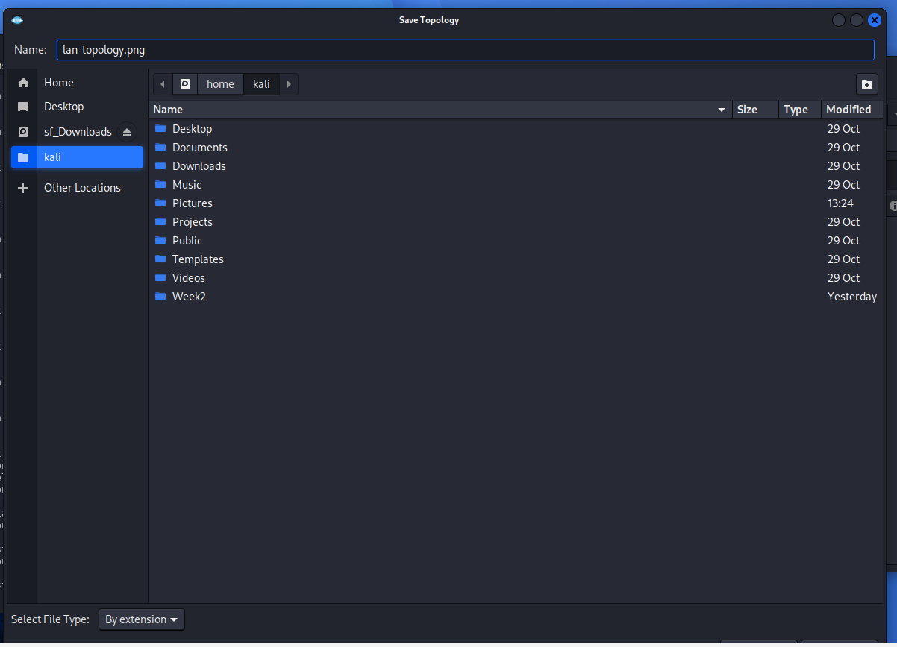
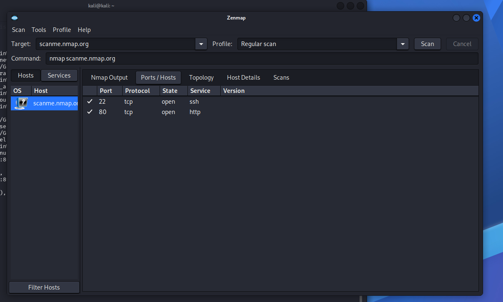
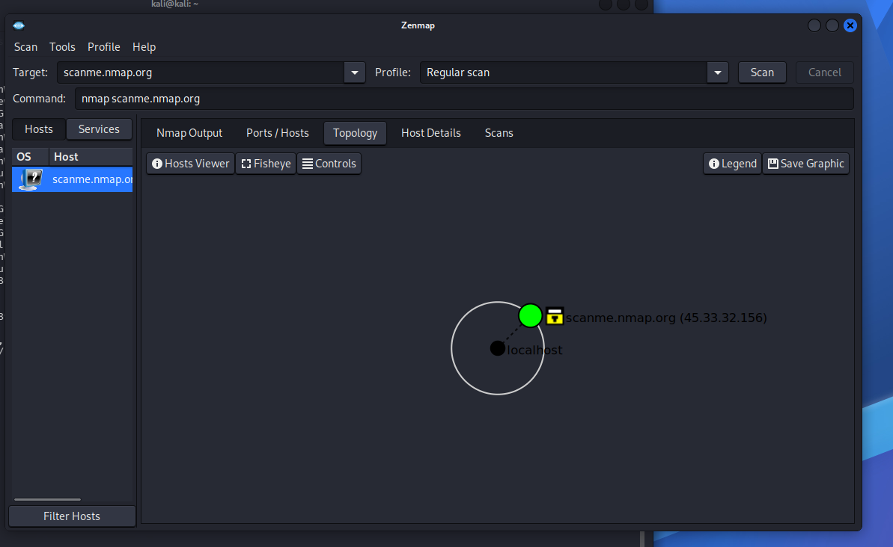

# Footprinting and Network Scanning Report

Passive reconnaissance with multiple Kali tools and network scanning with Zenmap, done inside my own lab.

   

## 1. Report Details

| Field | Detail |
|---|---|
| Pentester Name | Aleena Zafar |
| Program / Batch | Networkwalks Cybersecurity Program, Batch B084 |
| Report | W2-PM-FINAL |
| Test dates | 10 November 2026 to 12 November 2026 |
| Modules completed | W2-PM1 (Footprinting with multiple Kali tools), W2-PM5 (Zenmap based Network Scanning), W2-PM-FINAL (this report) |
| Authorization | Self-issued scope document: [Letter-of-Authorization-B084-WK2.pdf](Letter-of-Authorization-B084-WK2.pdf) |

## 2. Liability Disclaimer

This work is for education and research only. All testing was done on my own virtual lab network and on a public practice server that is provided for scanning practice. No system was tested without permission, and no exploitation, brute-force or denial-of-service activity was carried out.

## 3. Introduction

This project covers Week 2 of the Networkwalks Cybersecurity Program (Batch B084). It follows the first two phases of a penetration test:

1. **Footprinting and reconnaissance (W2-PM1):** collecting public information about a target using six Kali Linux tools.
2. **Network scanning (W2-PM5):** discovering live hosts and open ports with Zenmap (the graphical front end of Nmap).

I chose **W2-PM1** as my elective module, and completed both essential modules (**W2-PM5** and **W2-PM-FINAL**).

## 4. Scope

| In scope | Notes |
|---|---|
| My own VirtualBox NAT Network `NatNetwork` (10.0.0.0/24) | Kali VM 10.0.0.2 and gateway 10.0.0.1, built in Week 1 |
| scanme.nmap.org (45.33.32.156) | Public server provided by the Nmap Project for practising scans |
| Public WHOIS and DNS lookups of nmap.org | Read-only, public registration data. nmap.org itself was not scanned |

I did not scan any office, home or public network, and no other target was tested.

## 5. Lab and Tools Used

| Item | Detail |
|---|---|
| Host OS | Windows 11 |
| Virtualization | VirtualBox 7.2.22 |
| Attacker machine | Kali Linux 2026.3 (VM on NAT Network, IP 10.0.0.2/24) |
| Scanner | Nmap and Zenmap 7.991 |
| Footprinting tools | whois, nslookup, dig, whatweb, wafw00f 2.4.2, dnsrecon |

## 6. Module W2-PM1: Footprinting with Multiple Kali Tools

Target: `scanme.nmap.org` (WHOIS was run on the parent domain `nmap.org`).

### 6.1 WHOIS

Command: `whois nmap.org`

Findings:
- Registrar: Dynadot Inc (IANA ID 472)
- Created 1999-01-18, last updated 2026-10-15, expires 2032-01-18
- Name servers: ns1.linode.com to ns5.linode.com
- DNSSEC: unsigned
- Domain status: clientTransferProhibited

### 6.2 nslookup

Command: `nslookup scanme.nmap.org`

Findings: DNS server 8.8.8.8 returned a non-authoritative answer. IPv4 address 45.33.32.156 and IPv6 address 2600:3c01::f03c:91ff:fe18:bb2f.

### 6.3 dig

Commands: `dig scanme.nmap.org ANY +noall +answer` and `dig scanme.nmap.org A`

Findings: status NOERROR, A record 45.33.32.156 and AAAA record 2600:3c01::f03c:91ff:fe18:bb2f. The full A query took 232 ms through 8.8.8.8.

### 6.4 WhatWeb

Command: `whatweb scanme.nmap.org`

Findings: HTTP 200 OK, web server Apache 2.4.7 on Ubuntu Linux, page title "Go ahead and ScanMe!", HTML5 and Google Analytics detected, IP 45.33.32.156. HTTPS (port 443) was refused, so WhatWeb fell back to HTTP.

### 6.5 wafw00f

Command: `wafw00f http://scanme.nmap.org`

Findings: no Web Application Firewall was detected by the generic detection (7 requests).

### 6.6 dnsrecon

Command: `dnsrecon -d scanme.nmap.org`

Findings: A record 45.33.32.156 and AAAA record 2600:3c01::f03c:91ff:fe18:bb2f. No DNSSEC answer and no SRV records were found (the two ERROR lines only mean these records do not exist).

## 7. Module W2-PM5: Network Scanning with Zenmap

### 7.1 Scan of my own lab network

Quick scan command: `nmap -T4 -F 10.0.0.0/24`

Findings: 256 IP addresses scanned in 16.28 seconds, **2 hosts up**.

| Host | Open ports | Notes |
|---|---|---|
| 10.0.0.1 | 53 (domain), 135 (msrpc), 445 (microsoft-ds) | MAC 52:54:00:12:35:00 (QEMU virtual NIC) |
| 10.0.0.2 | None (all 100 scanned ports filtered) | My own Kali VM |

### 7.2 Intense scan of the gateway

Command: `nmap -T4 -A -v 10.0.0.1`

Findings:
- Open ports: 53 (dnsmasq 2.51), 135 (Microsoft Windows RPC), 445 (microsoft-ds), 902 (iss-realsecure?) and 912 (apex-mesh?). The other 995 ports were filtered.
- OS guess: AT&T BGW210 (93%), Oracle VirtualBox Slirp NAT bridge (88%), QEMU (87%). Nmap warned that this result may be unreliable, so it is only an estimate.
- SMB2 message signing is enabled and required (SMB 3.1.1).
- Traceroute: 1 hop (3.90 ms). Scan time 39.84 seconds.

### 7.3 Topology

The topology shows my Kali VM (10.0.0.2) and the gateway (10.0.0.1) one hop apart. I saved it with Zenmap's Save Graphic option as `lan-topology.png`.

### 7.4 Scan of the public practice target

Command: `nmap scanme.nmap.org` (Regular scan)

Findings: host up (latency 0.0023 s), scanned in 121.77 seconds.

| Port | State | Service |
|---|---|---|
| 22/tcp | open | ssh |
| 80/tcp | open | http |

707 ports were filtered and 291 were closed. The Regular scan does not detect versions or hops, so the web server version (Apache 2.4.7) comes from the WhatWeb result above.

## 8. Summary of Observations

- Public information such as registrar, name servers and IP addresses can be collected without touching the target's systems.
- scanme.nmap.org runs an old Apache 2.4.7 on Ubuntu. This is expected for a practice server, but in a real environment an outdated web server would need patching.
- Only SSH (22) and HTTP (80) are open on scanme.nmap.org, and no WAF was detected.
- In my lab, the gateway exposes DNS, RPC and SMB. SMB signing is required, which is a good setting. These services should stay inside the isolated NAT Network and must not be exposed.

## 9. Troubleshooting

**Problem 1:** `whois scanme.nmap.org` returned "Malformed request".
**Solution:** WHOIS works on registered domains, not subdomains, so I queried the parent domain with `whois nmap.org`.

**Problem 2:** `apt install zenmap-kbx` returned "Unable to locate package".
**Solution:** That package name is not in this Kali release. Zenmap is available as `zenmap`, and I confirmed it with `which zenmap` and Help > About (version 7.991).

**Problem 3:** WhatWeb printed "Connection refused" for port 443.
**Solution:** This is not a failure. HTTPS is closed on the target, so WhatWeb fell back to HTTP and returned the result.

**Problem 4:** dnsrecon showed ERROR lines.
**Solution:** They only mean the target has no DNSSEC answer and no SRV records. The enumeration completed normally.

## 10. Key Learnings

- The difference between passive footprinting and active scanning.
- How to read WHOIS, DNS, web server and WAF information from the Kali tools.
- How to scan a subnet with Zenmap, read live hosts, open ports and the topology.
- Why scans must stay inside a written scope, and why I only scanned my own lab and a public practice server.

## Next Steps

- Continue with the next weekly projects of the Networkwalks Cybersecurity Program.
- Practise more scan types on my own lab machines.

Part of the Networkwalks Cybersecurity Program, Batch B084.
